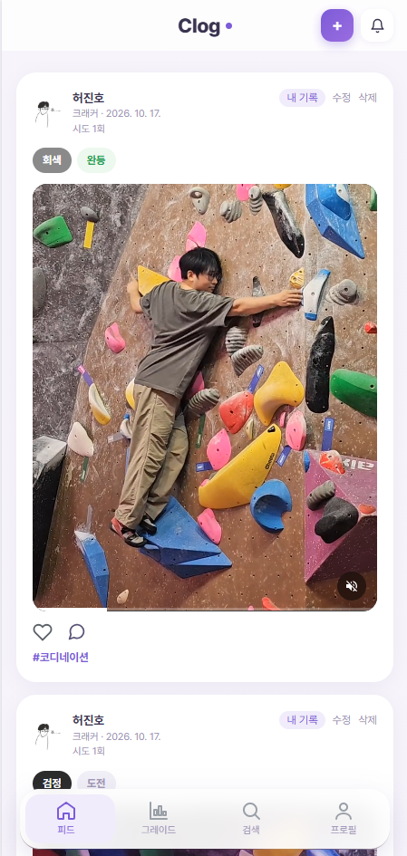
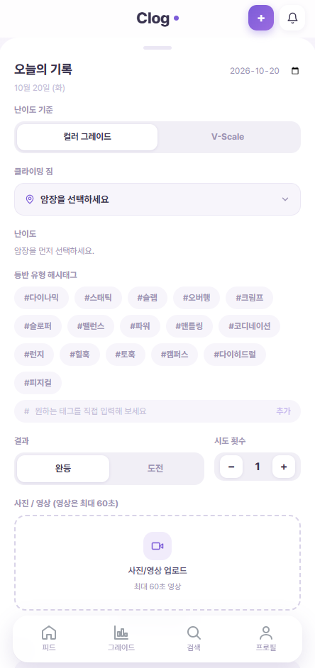
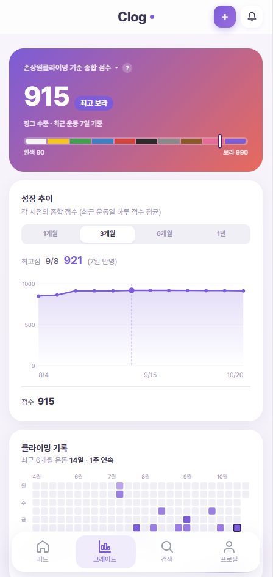
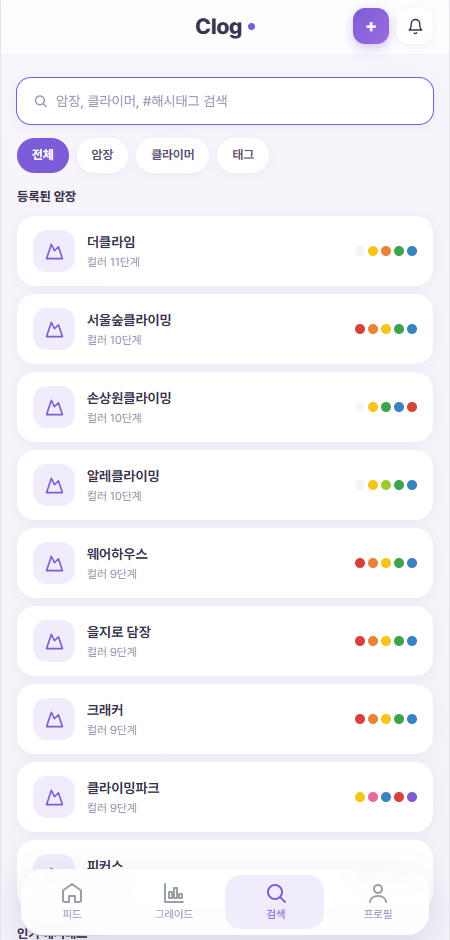
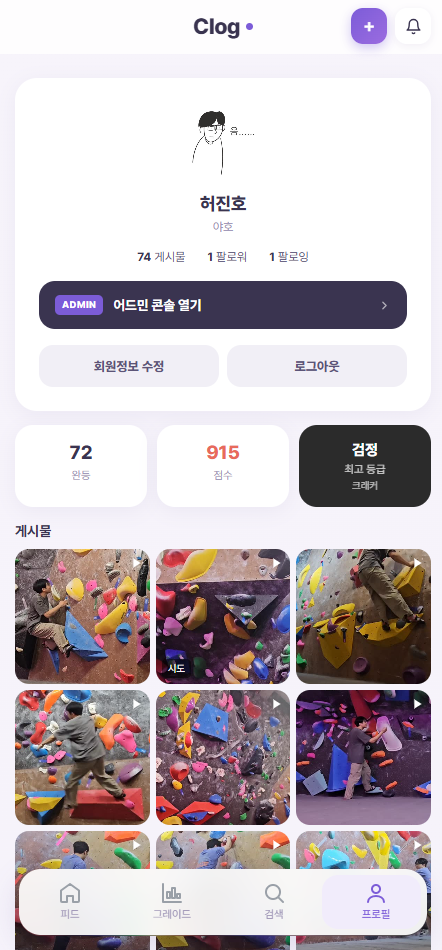

# 🧗 Clog Frontend

> 클라이밍 기록 서비스 **Clog(Climb + Log)** 의 웹·모바일 프론트엔드.
> 암장마다 제각각인 색깔 난이도를 하나의 점수로 비교하고, 영상으로 공략(베타)을 공유합니다.

**서비스** [climb-log.com](https://climb-log.com) · **Backend** [clog-backend](https://github.com/miginho12/clog-backend) · **Infra** [gitops](https://github.com/miginho12/gitops)

기획부터 설계·개발·배포·운영까지 1인으로 진행했고, 실제 사용자가 쓰는 prod 환경을 라즈베리파이 5 위의 k3s 클러스터에서 직접 운영하고 있습니다.

<table>
  <tr>
    <td align="center"></td>
    <td align="center"></td>
    <td align="center"></td>
    <td align="center"></td>
    <td align="center"></td>
  </tr>
  <tr>
    <td align="center">기록 피드</td>
    <td align="center">기록 작성</td>
    <td align="center">그레이드</td>
    <td align="center">검색</td>
    <td align="center">프로필</td>
  </tr>
</table>

---

## 🛠 기술 스택

| 영역 | 기술 |
|---|---|
| UI | React 19, TypeScript, Vite, Tailwind CSS 4, framer-motion |
| 라우팅 | react-router-dom 7 (SPA) |
| 모바일 | Capacitor 8 (Android·iOS WebView 앱) |
| 서빙 | nginx 1.27 (정적 파일 + `/api`·미디어 리버스 프록시) |
| CI/CD | GitHub Actions (eslint · tsc · npm audit → 멀티아키 이미지 빌드) → GitOps → ArgoCD |

---

## ✨ 주요 기능

- **기록 피드**: 페이지 단위 피드(더 보기), 암장·태그·작성자별 피드, 공개/비공개 설정
- **기록 작성**: 사진·영상 업로드, 여러 문제를 한 번에 올리는 일괄 업로드
- **그레이드**: V스케일·색깔 난이도 점수, 성장 추이 차트, 깃허브 잔디 같은 운동 기록 히트맵, 암장별 내 수준
- **들찍(팔로우캠)**: 업로드 전 미리보기에서 따라갈 사람을 탭으로 지정 → 서버가 그 사람을 따라가는 화면으로 렌더링
- **소셜**: 승인제 팔로우(비공개 계정), 좋아요, 대댓글·고정 댓글, 알림
- **인증**: 카카오 로그인 + 이메일 회원가입·인증, 비밀번호 찾기
- **관리자**: 콘텐츠 삭제, 암장 등급 체계·보정치 관리, 사용자 차단

---

## 🔧 구현 포인트

### 1. 끊겨도 이어지는 영상 분할 업로드 — [`src/lib/multipartUpload.ts`](src/lib/multipartUpload.ts)
폰 + 와이파이 환경에서 대용량 영상 업로드가 시작 후 35~40초 만에 끊기는 문제가 있었습니다. 경로별로 재현해 보니 서버가 아니라 사용자 네트워크 구간의 문제였고, 서버에서 고칠 수 없는 구간이라 **앱이 견디는 쪽**으로 설계를 바꿨습니다.

- 영상은 크기와 상관없이 전부 **16MiB 조각**으로 나눠 presigned URL로 스토리지에 직접 업로드 (동시 3개)
- 조각마다 최대 3회 시도, 실패한 조각만 재시도
- 올라간 조각을 `localStorage`에 기록해, 앱을 껐다 켜도 **같은 파일이면 이어 올리기** (24시간)
- 서버가 조각 개수·크기를 검증한 뒤 합치므로 깨진 영상은 게시되지 않음

### 2. 업로드 중에도 앱을 자유롭게 — [`src/lib/upload.tsx`](src/lib/upload.tsx)
업로드를 전역 대기열(Context)로 관리하고, 하단 탭바 위의 배너로 진행 상황을 보여줍니다. 작성 화면을 벗어나도 업로드는 계속되며, 실패한 건은 입력값을 다시 채울 필요 없이 그대로 재시도할 수 있습니다.

### 3. 토큰 자동 갱신 — [`src/api/client.ts`](src/api/client.ts)
모든 API 호출을 `client.ts`의 함수로 모으고, `authFetch` 래퍼가 401을 받으면 Refresh 토큰으로 Access 토큰을 갱신한 뒤 1회 재시도합니다. 페이지 코드는 인증 만료를 신경 쓰지 않습니다.

### 4. 이미지 한 번 빌드, dev·prod 승격만 — [`Dockerfile`](Dockerfile) · [`nginx.conf.template`](nginx.conf.template)
- 백엔드 주소를 nginx `envsubst` 템플릿 변수(`CLOG_BACKEND_HOST`)로 빼서, **같은 이미지**를 dev·prod에 그대로 배포합니다 (재빌드 없이 승격).
- `NGINX_ENVSUBST_FILTER=^CLOG_`로 치환 대상을 한정해 nginx 자체 변수(`$host` 등)가 지워지지 않게 했습니다.
- 영상 스트리밍을 위해 미디어 경로는 `proxy_buffering off`, 업로드는 `proxy_request_buffering off`로 흘려보냅니다.
- `index.html`은 `no-cache`, 해시가 붙은 `/assets/`는 1년 `immutable` 캐시. 배포 후 모바일 WebView가 옛 화면을 띄우던 문제를 이 설정으로 해결했습니다.

### 5. 웹과 앱을 한 코드로 — Capacitor
같은 React 코드를 Capacitor로 감싸 Android·iOS 앱으로 빌드합니다. 카카오 로그인이 시스템 브라우저로 튕기지 않도록 `allowNavigation`에 인증 도메인을 등록해, 로그인 전체 흐름이 앱 안에서 끝나게 했습니다.

---

## 📁 디렉토리 구조

```
clog-frontend/
├── src/
│   ├── api/client.ts      # 모든 API 호출 (authFetch: 401 → 토큰 갱신 → 재시도)
│   ├── lib/               # 업로드 대기열, 분할 업로드, 인증 토큰, 날짜·색상 유틸
│   ├── components/        # AppLayout(탭바·스와이프), 피드 카드, 댓글, 차트, 히트맵 등
│   └── pages/             # 피드, 기록 작성(단건·일괄), 그레이드, 프로필, 검색, 알림, 관리자
├── android/ · ios/        # Capacitor 네이티브 프로젝트
├── nginx.conf.template    # SPA 서빙 + /api·미디어 프록시 (envsubst)
├── Dockerfile             # node 빌드 → nginx 런타임 멀티스테이지
└── .github/workflows/     # 이미지 빌드·배포, Android·iOS 빌드 검증
```

---

## 🚀 로컬 실행

```bash
npm ci
npm run dev          # http://localhost:5173
```

API는 `.env.development`의 `VITE_API_BASE_URL`(기본 `http://localhost:8080`)로 호출합니다. 백엔드 로컬 실행은 [clog-backend](https://github.com/miginho12/clog-backend) 참고.

```bash
npm run lint         # eslint
npm run build        # tsc -b && vite build (커밋 전 필수)
npm run cap:sync     # 모바일 빌드 후 Capacitor 동기화
```

---

## 📦 배포 흐름

```
git push (main)
  → GitHub Actions: eslint · tsc · npm audit
  → Docker buildx (linux/amd64 + arm64) → ghcr.io, sha-<커밋> 태그
  → gitops 레포의 values-dev.yaml 이미지 태그 자동 갱신
  → ArgoCD: dev 자동 동기화
  → dev 검증 후 같은 sha 태그를 values-prod.yaml로 승격 → prod 수동 동기화
```

Android·iOS 빌드는 별도 워크플로로 앱 관련 파일이 바뀐 push마다 빌드 가능 여부를 검증하고, 실패하면 Discord로 알림을 보냅니다.
